# KFS-1 — Educational Bare-Metal 32-bit Operating System

KFS-1 is a minimal, educational bare-metal 32-bit operating system kernel designed as a hands-on learning platform for OS development concepts. It demonstrates fundamental OS internals including hardware abstraction, interrupt handling, VGA text console, and keyboard input processing.

> Based on [OSDev Bare Bones](https://wiki.osdev.org/Bare_Bones)

---

## Table of Contents

- [Features](#features)
- [Project Structure](#project-structure)
- [Architecture Overview](#architecture-overview)
- [Core Components](#core-components)
  - [Boot Layer](#boot-layer)
  - [Global Descriptor Table (GDT)](#global-descriptor-table-gdt)
  - [Interrupt Descriptor Table (IDT)](#interrupt-descriptor-table-idt)
  - [VGA Console System](#vga-console-system)
  - [Keyboard Input Processing](#keyboard-input-processing)
  - [Utility Functions](#utility-functions)
- [Getting Started](#getting-started)
  - [Prerequisites](#prerequisites)
  - [Build & Run](#build--run)
- [Build System](#build-system)
  - [Makefile Targets](#makefile-targets)
  - [Compiler & Linker Flags](#compiler--linker-flags)
  - [Linker Script](#linker-script)
- [Usage](#usage)
  - [Screens](#screens)
  - [Commands](#commands)
- [Troubleshooting](#troubleshooting)

---

## Features

- **Multiboot-compliant boot process** with GRUB integration
- **Protected mode** with GDT-based memory segmentation (kernel & user segments)
- **Interrupt-driven keyboard input** via PIC remapping and IDT
- **VGA text console** with 80×25 character grid and memory-mapped I/O at `0xB8000`
- **5 virtual screens** — 3 user terminals (F1–F3), system tester (F4), system log (F5)
- **Interactive command system** with `kfs>` prompt and input buffer
- **Smart backspace** — cannot delete past the prompt boundary
- **Color customization** — change foreground/background colors via `color` command
- **System tester (F4)** — runs 7 automated tests (GDT, IDT, VGA, colors, screens, keyboard, scroll)
- **System log (F5)** — displays boot events and kernel messages
- **Automatic scrolling** and hardware cursor management
- **printf-style formatted output** (`printk`) with `%c`, `%s`, `%d`, `%x` specifiers
- **US keyboard layout** scancode translation
- **Easter eggs** 🥚

---

## Project Structure

```
kfs-1-2/
├── boot.s            # Assembly entry point, Multiboot header, ISR stubs
├── kernel.c          # Kernel main, terminal system, screen management
├── kernel.h          # Constants, types, function declarations<>
├── kernel_utils.c    # I/O ports, cursor, printk, memset, memcpy, itoa
├── gdt.c             # GDT initialization and segment descriptor setup
├── gdt.h             # GDT structures and prototypes
├── idt.c             # IDT initialization, PIC remapping, ISR binding
├── idt.h             # IDT structures and prototypes
├── keyboard.c        # Keyboard interrupt handler, scancode translation
├── keyboard.h        # Keyboard handler prototype
├── linker.ld         # Linker script — entry point, memory layout, sections
└── Makefile          # Build automation — compile, link, ISO, run
```

---

## Architecture Overview

The system follows a layered architecture from hardware initialization to user interaction:

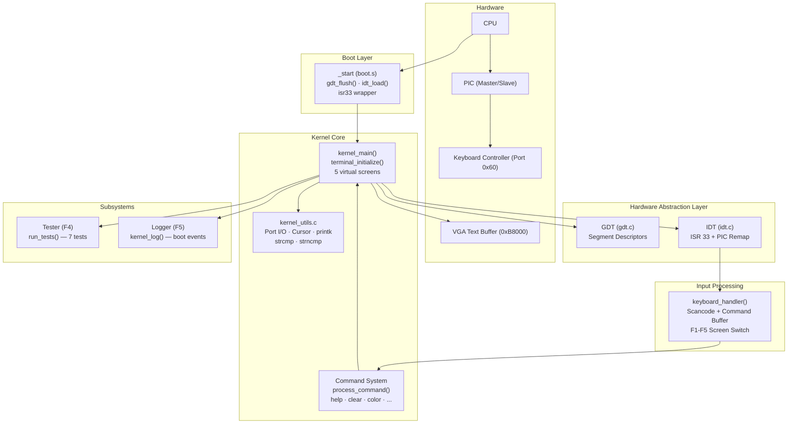

### Boot Sequence

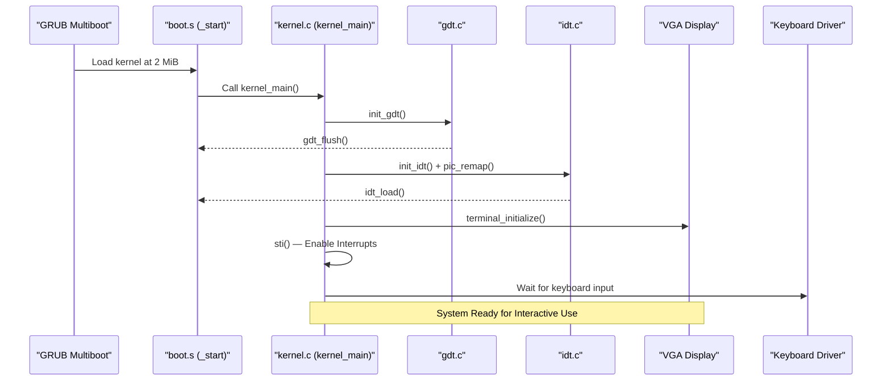

---

## Core Components

### Boot Layer

**File:** `boot.s`

- Emits a **Multiboot header** (magic number, flags, checksum) for GRUB recognition
- Allocates a **16 KiB aligned stack** for kernel use
- Transfers control from `_start` to `kernel_main()` in C
- Provides assembly helpers:
  - `gdt_flush()` — loads GDT and updates segment registers
  - `idt_load()` — installs the IDT
  - `isr33` — keyboard ISR wrapper (saves registers → calls C handler → restores → `iret`)

### Global Descriptor Table (GDT)

**Files:** `gdt.c`, `gdt.h`

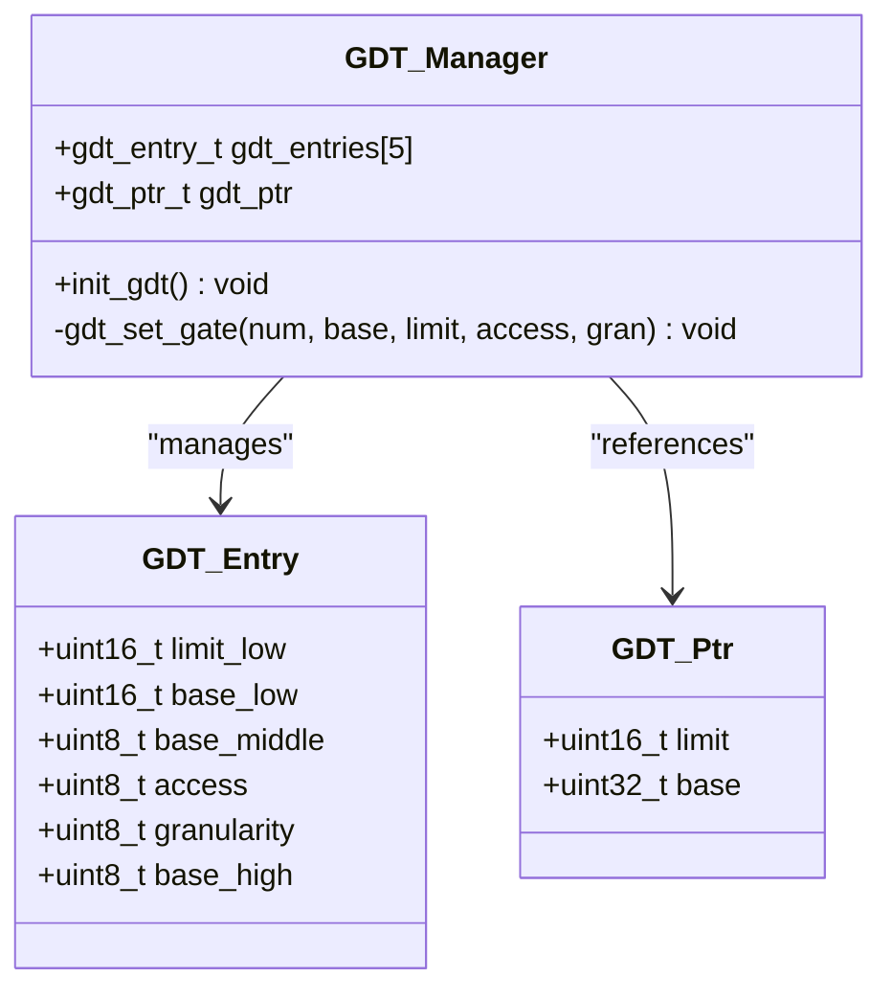

Defines 5 segment descriptors for protected mode:

| Index | Segment | Ring | Purpose |
|-------|---------|------|---------|
| 0 | Null | — | Required null descriptor |
| 1 | Kernel Code | 0 | Executable, kernel-mode |
| 2 | Kernel Data | 0 | Read/Write, kernel-mode |
| 3 | User Code | 3 | Executable, user-mode |
| 4 | User Data | 3 | Read/Write, user-mode |

Each entry is a packed structure with base, limit, access, and granularity fields. The GDT pointer holds the limit and base address, loaded via `gdt_flush()`.

### Interrupt Descriptor Table (IDT)

**Files:** `idt.c`, `idt.h`

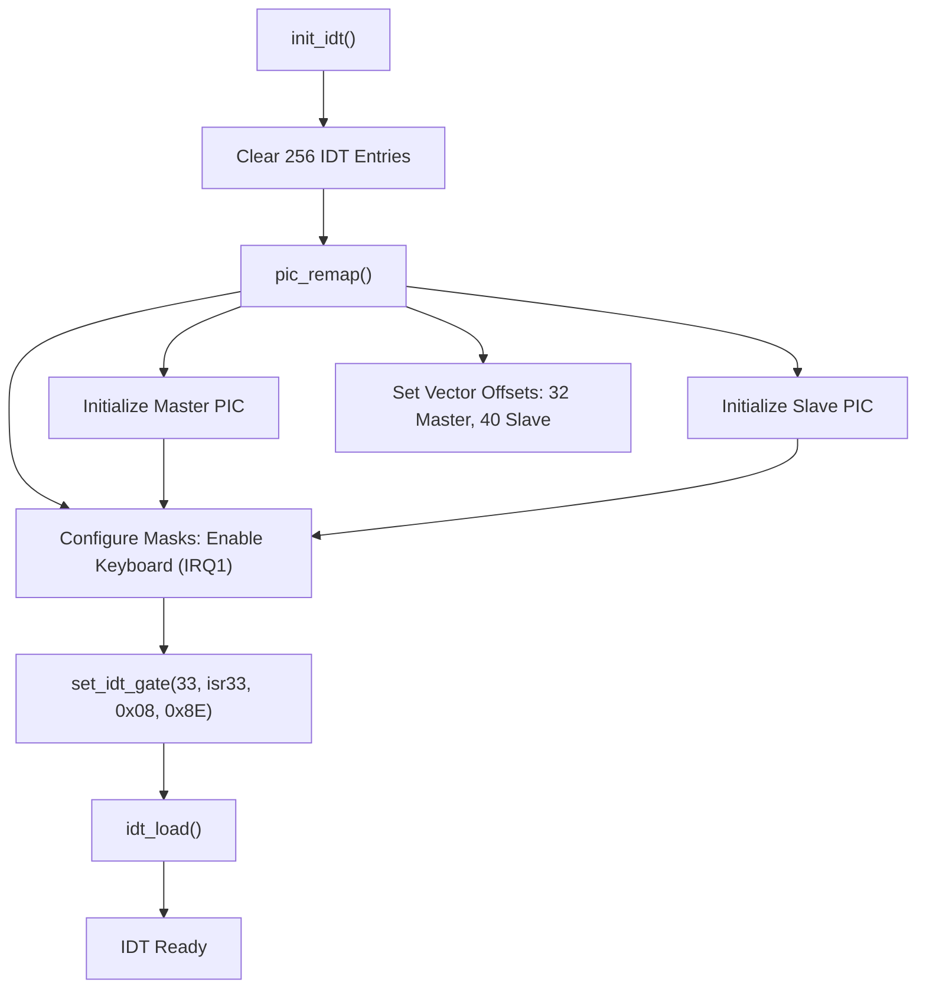

- Allocates **256 IDT entries** and clears them with `memset`
- **PIC Remapping:** Remaps IRQ0–IRQ7 to vectors 32–39 and IRQ8–IRQ15 to vectors 40–47 to avoid conflicts with CPU exceptions
- Binds **ISR 33** (IRQ 1 = keyboard) to the assembly wrapper `isr33`
- Configures PIC masks to enable **only keyboard interrupts**
- Loads the IDT via `idt_load()`

### VGA Console System

**Files:** `kernel.c`, `kernel.h`, `kernel_utils.c`

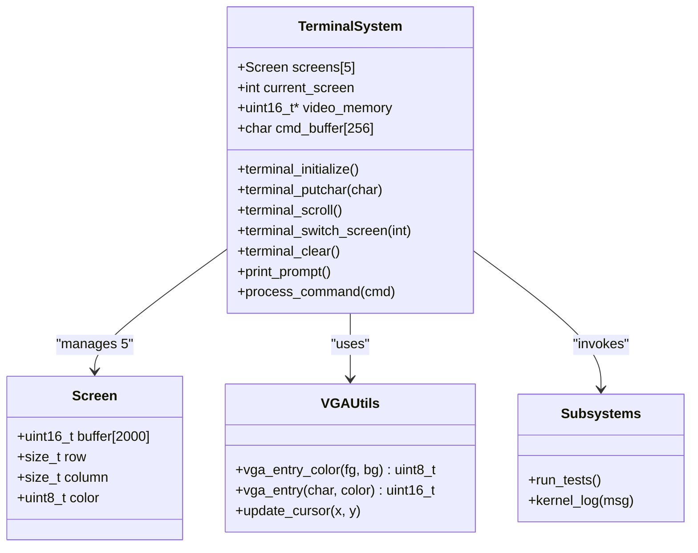

The console provides a full-screen text display at `0xB8000`:

- **5 virtual screens** — 3 user terminals + tester (F4) + log (F5), each with its own 80×25 buffer, cursor, and color
- **Interactive prompt** — `kfs>` prompt with command buffer and input boundary protection
- **Color attributes** — 16 foreground × 16 background colors, packed as `fg | (bg << 4)`
- **Character cells** — 16-bit values: `character | (attribute << 8)`
- **Smart backspace** — cannot delete past the `kfs>` prompt
- **Scrolling** — when cursor reaches row 25, all rows shift up and the last row is cleared
- **Hardware cursor** — updated via VGA CRT registers (`0x3D4`/`0x3D5`) after every character
- **Screen switching** — `terminal_switch_screen(index)` copies the selected buffer to VGA memory and repositions the cursor
- **printk()** — printf-style formatter supporting `%c`, `%s`, `%d`/`%i`, `%x`, `%%`

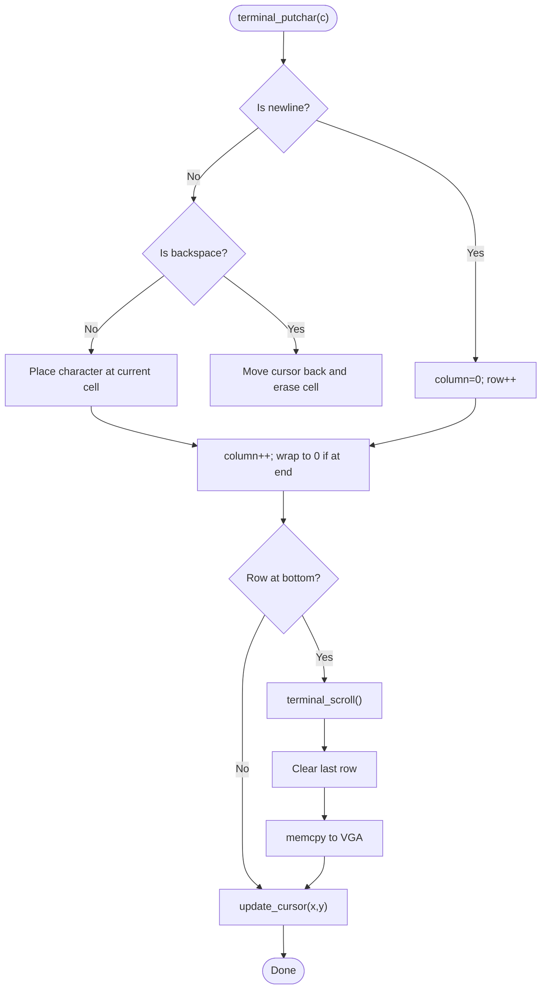

### Keyboard Input Processing

**Files:** `keyboard.c`, `keyboard.h`

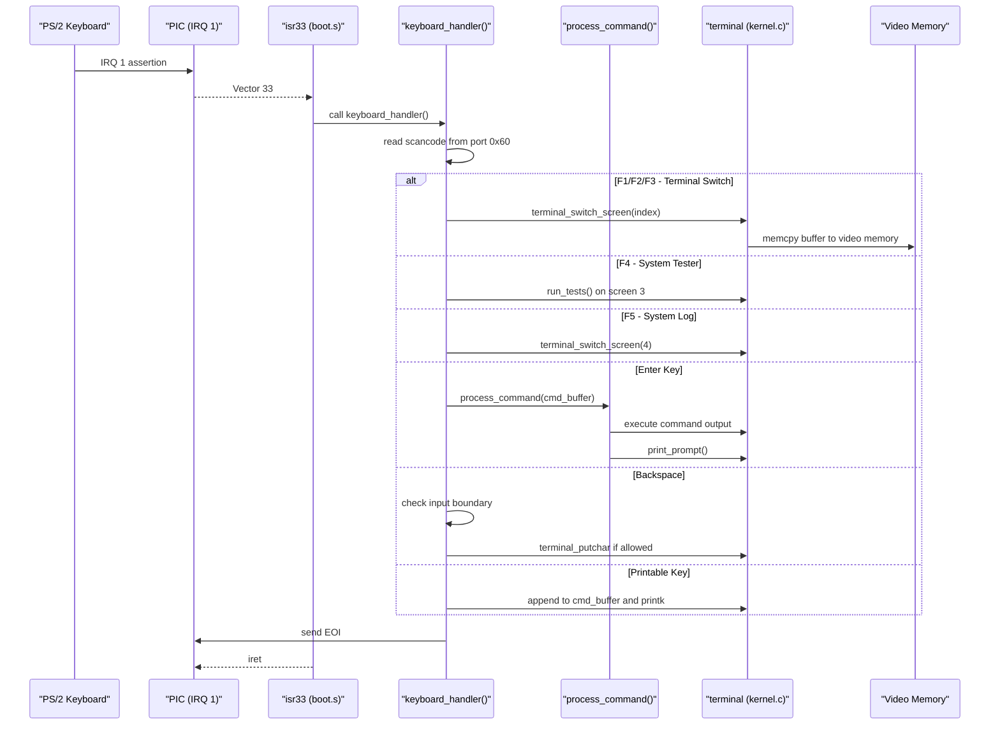

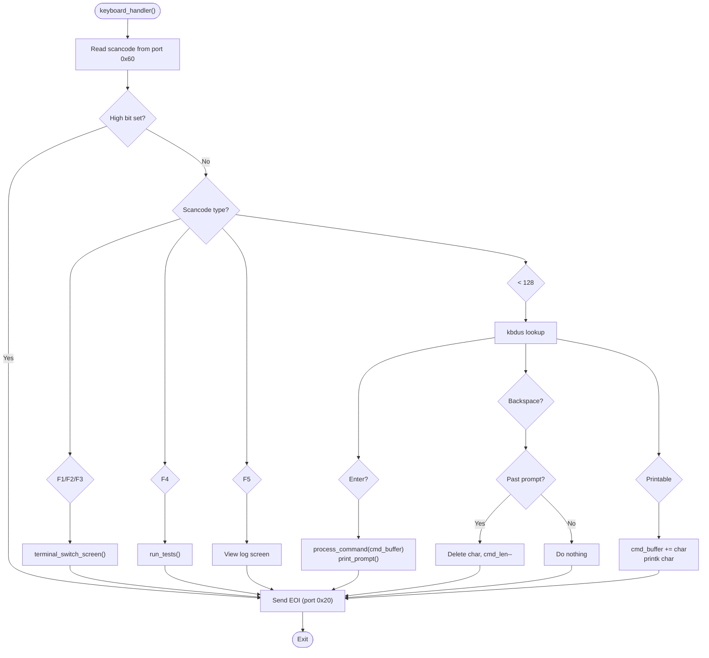

### Utility Functions

**File:** `kernel_utils.c`

| Function | Description |
|----------|-------------|
| `outb(port, val)` | Write byte to I/O port |
| `inb(port)` | Read byte from I/O port |
| `update_cursor(x, y)` | Set hardware cursor position |
| `enable_cursor(start, end)` | Configure cursor shape |
| `vga_entry_color(fg, bg)` | Pack color attribute byte |
| `vga_entry(c, color)` | Pack character + color into 16-bit cell |
| `strlen(str)` | String length |
| `memset(ptr, val, n)` | Fill memory |
| `memcpy(dst, src, n)` | Copy memory |
| `itoa(val, buf, base)` | Integer to ASCII string |
| `printk(fmt, ...)` | Formatted output to console |

---

## Getting Started

### Prerequisites

Install the required toolchain on **Debian/Ubuntu**:

```bash
sudo apt install build-essential nasm qemu-system-x86 xorriso grub-pc-bin gcc-multilib
```

This provides:
- **NASM** — assembler for `boot.s`
- **GCC** — C compiler with `-m32` cross-compilation support
- **LD** — linker (binutils)
- **GRUB** — `grub-mkrescue` for ISO creation
- **QEMU** — `qemu-system-i386` for emulation
- **xorriso** — required by `grub-mkrescue`

### Build & Run

```bash
# Build everything and create ISO
make

# Run in QEMU
make run

# Clean build artifacts
make clean
```

**Or manually:**

```bash
# 1. Assemble boot code
as --32 boot.s -o boot.o

# 2. Compile C sources
gcc -m32 -ffreestanding -fno-builtin -fno-exceptions -c kernel.c -o kernel.o
gcc -m32 -ffreestanding -fno-builtin -fno-exceptions -c kernel_utils.c -o kernel_utils.o
gcc -m32 -ffreestanding -fno-builtin -fno-exceptions -c gdt.c -o gdt.o
gcc -m32 -ffreestanding -fno-builtin -fno-exceptions -c idt.c -o idt.o
gcc -m32 -ffreestanding -fno-builtin -fno-exceptions -c keyboard.c -o keyboard.o

# 3. Link
ld -m elf_i386 -T linker.ld -o kernel.bin boot.o kernel.o kernel_utils.o gdt.o idt.o keyboard.o

# 4. Create bootable ISO
mkdir -p isodir/boot/grub
cp kernel.bin isodir/boot/kernel.bin
echo "menuentry 'KFS-1' { multiboot /boot/kernel.bin }" > isodir/boot/grub/grub.cfg
grub-mkrescue -o myos.iso isodir

# 5. Run
qemu-system-i386 -cdrom myos.iso
```

---

## Build System

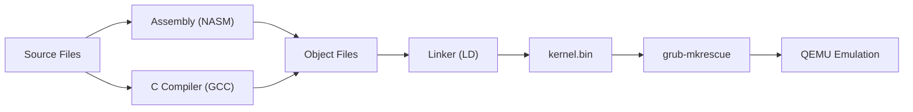

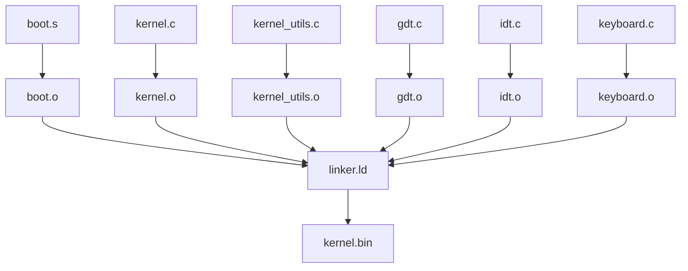

### Makefile Targets

| Target | Description |
|--------|-------------|
| `make` / `make all` | Build `kernel.bin` and create `myos.iso` |
| `make run` | Build and launch in QEMU |
| `make clean` | Remove all build artifacts |

### Compiler & Linker Flags

| Flag | Purpose |
|------|---------|
| `-m32` | 32-bit x86 target |
| `-ffreestanding` | No standard library assumptions |
| `-fno-builtin` | Don't use built-in function optimizations |
| `-fno-exceptions` | Disable C++ exceptions |
| `-m elf_i386` | Linker: ELF i386 output format |
| `-T linker.ld` | Use custom linker script |

### Linker Script

**File:** `linker.ld`

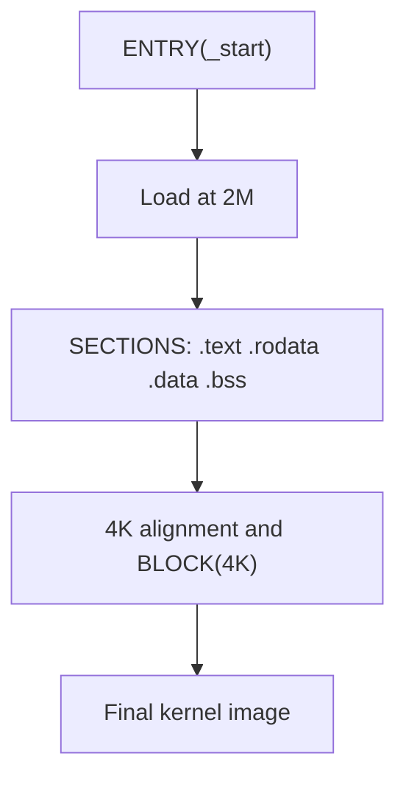

- **Entry point:** `_start` (assembly symbol)
- **Load address:** 2 MiB (safe for modern firmware)
- **Section ordering:** `.multiboot` → `.text` → `.rodata` → `.data` → `.bss`
- **Alignment:** 4 KiB boundaries for page-aligned sections

The Multiboot header is placed in its own section before `.text` to ensure the bootloader detects it within the first 8 KiB of the binary.

---

## Usage

After booting, the kernel initializes and presents a `kfs>` prompt on **Terminal 1** (F1).

### Screens

| Key | Screen | Description |
|-----|--------|-------------|
| **F1** | Terminal 1 | Main user terminal (green) |
| **F2** | Terminal 2 | Second workspace (cyan) |
| **F3** | Terminal 3 | Third workspace (yellow) |
| **F4** | Tester | Runs 7 automated system tests |
| **F5** | System Log | Boot events and kernel messages |

Each terminal (F1–F3) has its own command buffer, cursor position, and color scheme. Switching preserves the content and state of each screen. The tester (F4) re-runs all tests each time you press F4. The log (F5) accumulates kernel events.

### Commands

Type commands at the `kfs>` prompt and press **Enter**:

| Command | Description |
|---------|-------------|
| `help` | Show all available commands |
| `clear` | Clear the current screen |
| `color <fg> <bg>` | Change text colors (0–15, see `help` for color table) |
| `whoami` | Display current screen info and cursor position |
| `stack` | Show the current stack pointer (ESP) |
| `reboot` | Reboot the system (triple fault) |
| `whoistheking` | 🥚 |

**Backspace** deletes characters but cannot go past the `kfs>` prompt. **Enter** submits the command.

---

## Troubleshooting

| Problem | Possible Cause | Solution |
|---------|---------------|----------|
| `as: command not found` | Missing assembler | Install `build-essential` and `nasm` |
| `grub-mkrescue` errors | Missing GRUB tools | Install `grub-pc-bin` and `xorriso` |
| Blank screen after boot | Multiboot header misaligned | Verify `boot.s` header and `linker.ld` section order |
| No keyboard response | IDT/PIC not configured | Check `init_idt()` and PIC remapping in `idt.c` |
| Characters not appearing | VGA buffer not synced | Ensure `terminal_putchar()` writes to both buffer and video memory |
| Screen switching broken | Invalid screen index | Verify F-key scancode handling in `keyboard.c` |
| Command not recognized | Typo or extra spaces | Commands are case-sensitive, check spelling |
| Backspace won't delete | At prompt boundary | This is intended — cannot delete the `kfs>` prompt |
| F4 tests fail | Kernel corruption | Run `make clean && make` and reboot |
| QEMU won't boot ISO | Corrupted ISO | Run `make clean && make` and verify ISO contents |